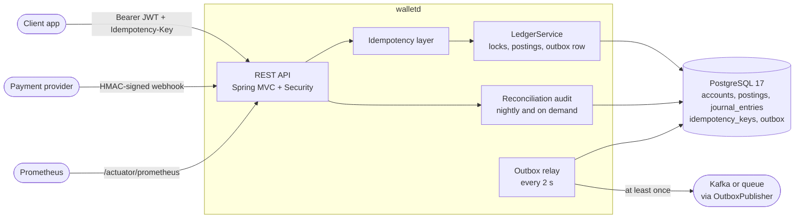
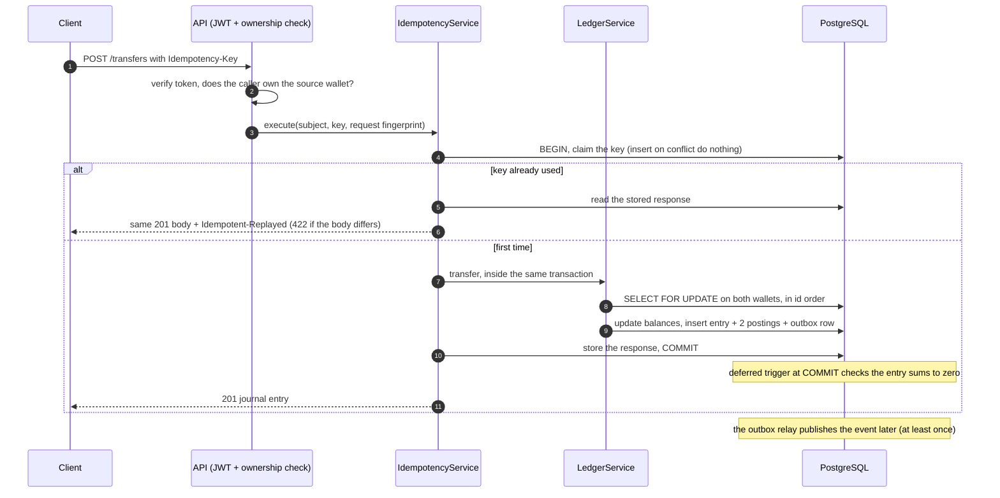
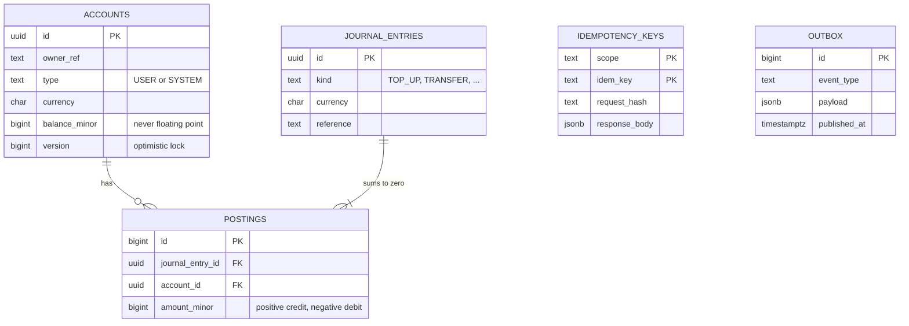

# walletd

[](https://github.com/WickTech/walletd/actions/workflows/ci.yml)


A double-entry wallet and payments service. Every money movement is a journal entry whose postings sum to zero, and **the database itself enforces that**, so a bug in the service can't create or destroy money.

It is a small service built the way a payments team would build it: safe to retry, safe under concurrency, auditable, and observable.

| Problem | How walletd handles it |
|---|---|
| A client times out and retries a payment | `Idempotency-Key`: the retry gets the stored response, money moves once |
| 20 requests spend the same wallet at once | Ordered row locks: exactly the affordable ones succeed, no deadlock |
| The payment provider delivers the same event five times | HMAC-signed webhook, credited once per payment id |
| The service crashes between "money moved" and "event sent" | Transactional outbox: the event row commits with the money |
| A bug or a manual SQL fix corrupts a balance | Constraint triggers refuse it, and a nightly audit would catch what slips through |

## Architecture



### Life of a transfer



### Data model



## What the database enforces

These hold even if the application code is wrong:

| Invariant | How |
|---|---|
| Every journal entry balances (at least 2 legs, sum = 0) | Deferred constraint trigger, checked at `COMMIT` |
| No mixed currencies inside an entry | Same trigger |
| User wallets never go negative | `CHECK (type = 'SYSTEM' OR balance_minor >= 0)` |
| History is append-only | `BEFORE UPDATE/DELETE` triggers on `postings` and `journal_entries` |
| No floating-point money | `bigint` minor units (paise for INR) |

Each one has a test in [`LedgerSchemaTests`](src/test/java/com/wicktech/walletd/LedgerSchemaTests.java). Migrations: [`src/main/resources/db/migration`](src/main/resources/db/migration).

## Design decisions

| Decision | Why | What I measured or rejected |
|---|---|---|
| **Ordered `SELECT … FOR UPDATE` row locks**, with `@Version` and a retry loop as a safety net | Transfers on a busy wallet queue instead of failing, and A→B / B→A can't deadlock | Optimistic locking alone: in 20 parallel ₹10 transfers from a ₹100 wallet, about half the requests ran out of retries even though funds remained. With ordered locks the same test gives exactly 10 × `201` and 10 × `422` |
| **Idempotency record stored in the same transaction** as the money movement | A crash can't leave "money moved, key not recorded" or the reverse; a parallel request with the same key blocks on the unique index and then replays | Failed requests are deliberately not stored, so a client can top up and retry with the same key |
| **Transactional outbox** instead of publishing from the request | Publishing after commit can lose the event; publishing before can announce money that never moved | Delivery is at least once, so consumers de-duplicate on the event id |
| **Webhook: verify the raw bytes before parsing**, constant-time compare, signed timestamp | Never trust unsigned input; a captured request can't be replayed after 5 minutes | The payment id is the idempotency key and is kept forever, so a very late redelivery can't credit twice |
| **Wallets you don't own return 404** | Account ids can't be probed | |
| **Top-ups are ADMIN only** | Otherwise any user could mint money; in production the signed webhook does it | |
| **Resource server, no password storage** | Tokens come from an identity provider; walletd only verifies them | HS256 with a shared secret is simple. See limitations |
| **Nightly audit as a second line of defence** | Triggers stop most corruption; the audit catches what a manual SQL fix or bad migration could still do | Runs in one `REPEATABLE READ` snapshot so concurrent transfers can't cause false alarms |
| **Tests on real PostgreSQL**, never H2 or mocks | The invariants live in Postgres triggers and locks | In-process Postgres locally, `postgres:17` in Docker in CI |

## Quick start

```bash
docker compose up -d                                    # Postgres 17 on :5432
export WALLETD_JWT_SECRET=$(openssl rand -hex 32)       # 32+ characters, verifies bearer tokens
export WALLETD_WEBHOOK_SECRET=$(openssl rand -hex 32)   # 32+ characters, verifies payment webhooks
WALLETD_DEV_TOKENS=true ./mvnw spring-boot:run          # local demos only: enables POST /dev/token
# health: http://localhost:8080/actuator/health    docs: http://localhost:8080/docs
```

Then, in another terminal:

```bash
tok() { curl -s localhost:8080/dev/token -H 'content-type: application/json' -d "$1" | jq -r .token; }
OPS=$(tok '{"subject":"ops","admin":true}'); ASHA=$(tok '{"subject":"asha"}'); RAVI=$(tok '{"subject":"ravi"}')

open() { curl -s localhost:8080/accounts -H "Authorization: Bearer $1" -H 'content-type: application/json' -d '{"currency":"INR"}' | jq -r .id; }
A=$(open $ASHA); B=$(open $RAVI)

# ops credits asha ₹100.00 (amounts are paise)
curl -s localhost:8080/accounts/$A/top-ups -H "Authorization: Bearer $OPS" -H 'content-type: application/json' \
  -H "Idempotency-Key: $(uuidgen)" -d '{"amountMinor":10000}'

# asha pays ravi ₹25.00; sending this exact request again returns the stored response, money moves once
KEY=$(uuidgen)
for i in 1 2; do
  curl -s -i localhost:8080/transfers -H "Authorization: Bearer $ASHA" -H 'content-type: application/json' \
    -H "Idempotency-Key: $KEY" \
    -d "{\"fromAccountId\":\"$A\",\"toAccountId\":\"$B\",\"amountMinor\":2500}" | grep -iE "^HTTP|idempotent-replayed"
done

curl -s localhost:8080/accounts/$B -H "Authorization: Bearer $RAVI"      # balanceMinor: 2500
```

`scripts/smoke.sh` runs a longer version of this (ownership rules, the signed webhook and its redelivery, the audit, metrics) and asserts every result. CI runs it against the Docker image.

**Full reference** (every endpoint, auth rules, idempotency table, webhook signing, outbox, metrics, configuration, Docker): [`docs/REFERENCE.md`](docs/REFERENCE.md).

## Testing

```bash
./mvnw verify                 # 46 tests on real PostgreSQL 17 started in-process, no Docker needed
./mvnw verify -Pcontainer     # the same tests on the official postgres:17 image (Testcontainers)
```

- **Invariants**: unbalanced, single-leg and mixed-currency entries, negative balances and edits to history are rejected by the database itself.
- **Concurrency**: parallel overspend, opposite-direction transfers (no deadlock), and a randomized load test (200 transfers from 16 threads over 6 wallets, repeated with fresh seeds, prints the seed on failure) that checks money is conserved and every balance equals its postings.
- **Idempotency**: replay, mismatch, retry after failure, and 20 parallel requests with one key creating exactly one entry.
- **Security**: missing, garbage, expired, wrong-issuer and wrongly-signed tokens; ownership; ADMIN-only top-ups.
- **Webhook and outbox**: forged, tampered, stale and malformed deliveries; 10 parallel deliveries of one payment; a failing broker; 4 parallel relays that never double-publish.
- **Audit and metrics**: a hand-edited balance is detected; metrics exist and are admin-only.
- **End to end**: CI builds the Docker image, runs it against Postgres and runs `scripts/smoke.sh`.

Bugs the tests caught while building this are in the commit history (for example `401` responses that were labelled `ISO-8859-1`, and a dev endpoint that rejected a body without `admin`).

## Limitations and what I would do next

- **Tokens are HS256 with a shared secret.** Fine for one service and a trusted issuer; in production verify asymmetric tokens from an identity provider (swap the `JwtDecoder` bean for a JWKS one).
- **One currency per wallet, no FX.** The schema reserves `REFUND` and `ADJUSTMENT` entry kinds, but there is no API for them yet (no refunds or holds).
- **Outbox order is only guaranteed with one relay.** With several instances, consumers must not rely on order (they must already de-duplicate).
- **The audit scans everything.** Fine for millions of rows once a night; at larger scale it would be incremental or run on a replica.
- **No rate limiting and only a `limit` on the postings list** (no cursor).
- **Not deployed.** The next step is the same service on AWS (ECS and RDS) with Terraform.

## Stack

Java 25 · Spring Boot 4.1 (Web MVC, Data JPA, Validation, Actuator, Security resource server) · springdoc OpenAPI · PostgreSQL 17 · Flyway · Micrometer and Prometheus · JUnit 5, AssertJ and Testcontainers · Docker · GitHub Actions

## License

MIT
