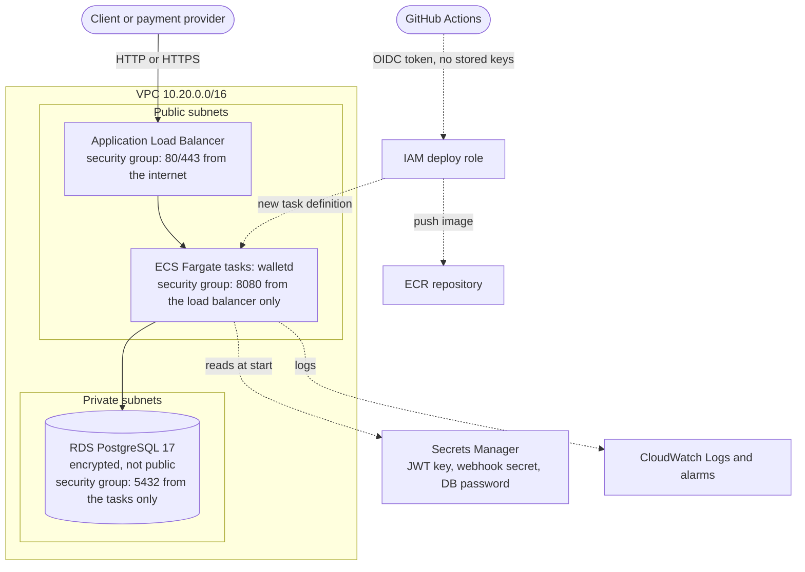

# Deploying walletd on AWS

Infrastructure as code for running walletd on AWS: containers on **ECS Fargate**, a managed **PostgreSQL 17** database on **RDS**, behind an **Application Load Balancer**, with secrets in **Secrets Manager** and keyless deploys from GitHub Actions.

The code is in [`aws/`](aws). It is plain HCL and works with **[OpenTofu](https://opentofu.org)** (open source, MPL-2.0, what CI uses) and with Terraform.

> **Free and open source.** Everything in this repository is MIT-licensed and built with open-source tools: OpenTofu, TFLint, Trivy, GitHub Actions on a public repository. Nothing here needs a paid tool or a paid account to read, test or validate. Only *running* it uses AWS, which bills for what it creates. You can tear everything down with one command.

## What gets built



| File | What it creates |
|---|---|
| `network.tf` | VPC, two public and two private subnets, routing, optional NAT gateway, the three security groups |
| `database.tf` | RDS PostgreSQL 17 (encrypted, private, backups, password managed by RDS in Secrets Manager) |
| `secrets.tf` | JWT signing key and webhook secret, generated and stored in Secrets Manager |
| `ecr.tf` | Image repository (immutable tags, scan on push, keeps the last 15 images) |
| `iam.tf` | Task execution role (reads only the three secrets) and an empty task role (the app calls no AWS APIs) |
| `alb.tf` | Load balancer, target group, HTTP listener, HTTPS listener when a certificate is given |
| `ecs.tf` | Cluster, task definition, service with automatic rollback, CPU-based autoscaling |
| `monitoring.tf` | Alarms: server errors, unhealthy tasks, slow responses, database CPU and free storage |
| `github_oidc.tf` | The keyless deploy role for the GitHub workflow |

## Decisions worth knowing

- **No passwords in the code.** RDS creates and stores the database password; ECS injects it into the container when it starts. The two application secrets are generated by Terraform and are also in the state file, so for anything real keep the state in an encrypted backend ([`backend.tf.example`](aws/backend.tf.example)).
- **Only the load balancer can reach the containers, and only the containers can reach the database.** The security groups reference each other instead of IP ranges.
- **Containers in public subnets by default.** Without a NAT gateway (about $33 a month) tasks need a public IP to pull images. They are still unreachable from the internet because only the load balancer's security group may connect. Set `use_nat_gateway = true` for the usual private-subnet layout.
- **Deployments are not Terraform's job.** The deploy workflow registers a new task definition per image and updates the service. The service ignores task-definition and task-count changes, so `apply` never undoes a deployment or fights autoscaling.
- **Bad releases roll back by themselves.** The ECS deployment circuit breaker rolls back when new tasks keep failing the health check.
- **Immutable image tags.** A tag always names the same image, so a rollback runs exactly what ran before.
- **No dev tokens in the cloud.** `WALLETD_DEV_TOKENS` is fixed to `false`; tokens must come from your identity provider, signed with the key in the `jwt-secret` secret (HS256).

## Cost (rough estimate)

While running, in a single zone's worth of capacity: **roughly $50 to $70 per month**: the load balancer (about $17 plus two public IPv4 addresses), one 0.5 vCPU / 1 GB Fargate task (about $20), a `db.t4g.micro` database with 20 GB (about $16), a few secrets and logs. A NAT gateway adds about $33. These are estimates from public list prices; prices differ by region and change, so check the [AWS Pricing Calculator](https://calculator.aws/) before you deploy. New AWS accounts often get free credits that cover a demo.

Writing, reading and validating this code costs nothing. If you deploy, run `tofu destroy` when you are done.

## Deploying

You need an AWS account, the AWS CLI logged in to it, Docker, and OpenTofu (or Terraform).

```bash
cd infra/aws
cp terraform.tfvars.example terraform.tfvars     # optional: change region, add an alarm email, ...
tofu init

# 1. Create the image repository first: the service needs an image to start.
tofu apply -target=aws_ecr_repository.app

# 2. Build and push the first image.
../scripts/push-image.sh "$(tofu output -raw ecr_repository_url)" bootstrap

# 3. Create everything else.
tofu apply

tofu output app_url                     # where it answers
tofu output github_actions_variables    # commands that wire up the deploy workflow
```

Check it: `curl "$(tofu output -raw app_url)/actuator/health"` should print `{"status":"UP",...}`. The first start takes about a minute (Flyway creates the schema).

Give the payment provider the webhook secret with the command in `tofu output webhook_secret_command`.

**Later releases:** run the GitHub workflow **Deploy to AWS** (Actions tab). It builds the image, tags it with the commit SHA, registers a new task definition, waits for a stable service and checks health.

**Roll back by hand:** `aws ecs update-service --cluster <cluster> --service <service> --task-definition <previous task definition ARN>`.

**Tear down:** `tofu destroy`. With the default `protect_data = false` this removes the database without a final snapshot. For real money set `protect_data = true` (deletion protection, final snapshot, secret recovery window).

## Before real money

This is a solid starting point, not a finished bank. Before you put real funds through it:

1. **Serve HTTPS.** Request a certificate in AWS Certificate Manager, point a DNS name at the load balancer and set `acm_certificate_arn`. Over plain HTTP, bearer tokens and webhooks travel in the clear.
2. Set `protect_data = true`, `db_multi_az = true` and `min_tasks = 2`.
3. Use an encrypted remote state backend.
4. Verify tokens from a real identity provider (asymmetric keys) instead of a shared secret.
5. Not covered here: a web application firewall, VPC flow logs, a customer-managed encryption key, a custom domain and DNS.

## Checks without an AWS account

[`.github/workflows/infra.yml`](../.github/workflows/infra.yml) runs on every change under `infra/`: `tofu fmt -check`, `tofu init -backend=false`, `tofu validate`, TFLint with the AWS ruleset, and a Trivy security scan that fails on HIGH or CRITICAL findings. None of them need credentials.
